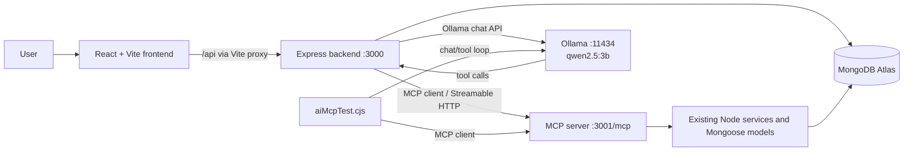

# Lexa — Project Overview and Technical Documentation

## 1. Project summary

Lexa is an AI-assisted household coordination application. It brings everyday
household tasks, shopping-list items, and reminders into one web interface, with
a natural-language assistant that can read household data and prepare selected
changes for the user to review.

The project is designed as a local-first prototype for the Amazon Developer
Hackathon, with Alexa+ as its primary track. It uses a locally hosted Ollama
model and a self-hosted Model Context Protocol (MCP) server to connect the AI to
the existing application services and MongoDB Atlas.

> **Scope note:** Lexa is currently a web application and local AI/MCP
> integration. This repository does not implement or deploy an Alexa skill or
> Alexa+ production integration.

## 2. Problem statement

Household responsibilities are often scattered across notes, conversations,
shopping lists, and reminders. That makes it harder to see what needs doing,
remember upcoming events, and keep shared information current. Conventional
forms can also make small changes feel tedious: a person may know what they want
to change but still need to find and edit the right record manually.

Lexa addresses this by combining a persistent household dashboard with a
conversational interface. People can manage records directly in the website or
ask the assistant questions in natural language. For supported writes, the
application shows a preview and asks for confirmation before changing data.

## 3. Goals and solution

- Provide one place to view and manage tasks, shopping items, and reminders.
- Persist household data in the existing MongoDB Atlas database.
- Offer a natural-language interface using a local language model.
- Connect model requests to real application operations through MCP tools.
- Keep consequential assistant writes under explicit user confirmation.
- Reuse the existing Express API, services, and models rather than duplicating
  database access in the frontend or AI client.

## 4. Main user-facing functionality

### Overview dashboard

- Shows counts of open tasks, unpurchased shopping items, and incomplete
  reminders.
- Shows a short task list and upcoming reminders.
- Includes an **Ask Lexa** call-to-action that opens the same assistant view as
  the left navigation.

### Tasks

- Create tasks with a title, optional description, priority, and due date.
- Show saved task records, their priority, status, and due date.
- Task status values are `pending`, `in_progress`, and `completed`.
- Priorities are `low`, `medium`, and `high`.

### Shopping list

- Add a named item and quantity.
- Display saved items and mark items as purchased or unpurchased.

### Reminders

- Create a reminder with a title and scheduled date/time.
- Display reminders and mark them complete or incomplete.

### Ask Lexa

- Answer household-data questions using read tools.
- Prepare task, shopping-item, and reminder creations for confirmation.
- Find an existing record and prepare supported field updates for confirmation.
- Show the current value and proposed value for each update.
- Cancel a pending change without writing to the database.
- Ask for clarification rather than updating when the target cannot be matched
  uniquely.
- Delete operations exist in MCP and are exercised by the terminal harness;
  deletion is not currently exposed as an Ask Lexa action.

## 5. Architecture



### Frontend

The frontend is a React application built with Vite. Its main views and
components are in [`frontend/src/App.jsx`](./frontend/src/App.jsx), with styling
in [`frontend/src/styles.css`](./frontend/src/styles.css). The Vite development
server proxies `/api` requests to the Express backend.

The Lexa logo is served from [`frontend/public/logo2.png`](./frontend/public/logo2.png)
and is also configured as the browser favicon in [`frontend/index.html`](./frontend/index.html).

### Express application backend

The backend starts from [`server/server.js`](./server/server.js) and mounts the
assistant routes in [`server/assistant.js`](./server/assistant.js). It serves
household CRUD APIs, connects to MongoDB Atlas with Mongoose, and makes
server-side requests to Ollama and the MCP server.

Assistant write actions are stored in an in-memory pending-action map with a
five-minute expiry. A confirmation consumes its ID before executing the action,
which prevents re-use. Update confirmation checks that the record still exists
and has not changed since the preview.

### MCP server

[`mcp-server/index.ts`](./mcp-server/index.ts) runs an Express-hosted MCP server
using the official `@modelcontextprotocol/sdk` and
`StreamableHTTPServerTransport`. It loads the existing backend environment
configuration, resolves the existing backend services, and registers tools
whose handlers call those services. The MCP server does not create a separate
database or a second set of persistence logic.

The MCP server is self-hosted by running the TypeScript entry point locally.
Clients connect over Streamable HTTP at `http://localhost:3001/mcp`; the server
maintains MCP sessions and exposes its tool definitions through `listTools()`.

### AI model

Lexa uses Ollama's local chat API at `http://localhost:11434/api/chat` with the
configured model `qwen2.5:3b`. The application does not send prompts to a paid
hosted AI API. The Ollama response may include tool calls; the backend passes
the selected tool result back to the model so it can continue reasoning.

## 6. MCP tool catalog

All 12 tools are registered in the MCP server and can be discovered by clients.
The IDs accepted by update/delete tools are MongoDB document IDs, not titles.

| Area | Tool | Purpose and main arguments |
|---|---|---|
| Tasks | `list_tasks` | Retrieve saved tasks. |
| Tasks | `create_task` | Create a task using `title`; optionally `description`, `dueAt`, `priority`, and `status`. |
| Tasks | `update_task` | Update selected task fields using `taskId` and one or more supported task fields. |
| Tasks | `delete_task` | Delete an existing task using `taskId`. |
| Shopping | `list_shopping_items` | Retrieve saved shopping-list items. |
| Shopping | `add_shopping_item` | Add an item using `name`; optionally `quantity`. |
| Shopping | `update_shopping_item` | Update `name`, `quantity`, or `purchased` using `itemId`. |
| Shopping | `delete_shopping_item` | Delete an existing item using `itemId`. |
| Reminders | `list_reminders` | Retrieve saved reminders. |
| Reminders | `create_reminder` | Create a reminder using `title` and ISO date-time `remindAt`. |
| Reminders | `update_reminder` | Update `title`, `remindAt`, or `completed` using `reminderId`. |
| Reminders | `delete_reminder` | Delete an existing reminder using `reminderId`. |

The tool handlers validate inputs using Zod schemas, use the existing service
functions, report missing records as errors, and return the result of the
service operation. Update services use Mongoose `findByIdAndUpdate` with
`new: true` and `runValidators: true`; delete services return the deleted
document or a missing-record result.

## 7. Assistant write-confirmation flow

1. The user sends a message to `/api/assistant/chat`.
2. The backend discovers available MCP tools and provides only supported
   read/create/update tools to Ollama.
3. A read tool may be called to retrieve existing records.
4. For an update, the backend matches the requested item against actual list
   results, checks supported field names and values, and creates a preview.
5. The browser displays the target and proposed changes with **Confirm** and
   **Cancel** buttons.
6. On confirmation, the backend consumes the pending action ID, revalidates it,
   checks that the record still exists and has not changed since preview, and
   then invokes the MCP tool.
7. The UI reports the result returned by the backend. A cancellation does not
   invoke the mutation tool.

Create actions use the same explicit confirmation pattern. Pending actions
expire after five minutes. Missing, expired, reused, or stale action IDs are
rejected instead of being treated as successful.

## 8. Data model

The three Mongoose models are in [`server/models/`](./server/models/); their
CRUD operations are in [`server/services/`](./server/services/).

| Entity | Fields |
|---|---|
| Task | `title` (required, up to 150 characters), `description` (up to 1000), `dueAt` (nullable date), `priority` (`low`, `medium`, `high`), `status` (`pending`, `in_progress`, `completed`). |
| Shopping item | `name` (required, up to 100 characters), `quantity` (integer-like numeric value, minimum 1), `purchased` (boolean). |
| Reminder | `title` (required, up to 150 characters), `remindAt` (required date), `completed` (boolean). |

MongoDB supplies each document's `_id`. Update/delete operations use that
document ID through their entity-specific argument names.

## 9. HTTP API overview

The Vite development proxy forwards `/api` to port 3000.

| Method | Path | Purpose |
|---|---|---|
| `GET` | `/api/health` | Backend health status. |
| `GET`, `POST` | `/api/tasks` | List tasks; create a task. |
| `GET`, `PATCH`, `DELETE` | `/api/tasks/:id` | Read, update, or delete a task. |
| `GET`, `POST` | `/api/shopping` | List shopping items; add an item. |
| `PATCH`, `DELETE` | `/api/shopping/:id` | Update or delete a shopping item. |
| `GET`, `POST` | `/api/reminders` | List reminders; create a reminder. |
| `PATCH`, `DELETE` | `/api/reminders/:id` | Update or delete a reminder. |
| `POST` | `/api/assistant/chat` | Ask Lexa a question or prepare a confirmed action. |
| `POST` | `/api/assistant/confirm` | Execute a valid pending write action. |
| `POST` | `/api/assistant/cancel` | Cancel a pending action. |

The MCP Streamable HTTP endpoint is `http://localhost:3001/mcp`.

## 10. Technology stack

| Layer | Technology |
|---|---|
| Frontend | React 19, Vite 6, JavaScript/JSX, CSS, Lucide icons. |
| Application API | Node.js, Express 5. |
| Persistence | MongoDB Atlas, Mongoose. |
| AI runtime | Ollama local HTTP API, `qwen2.5:3b`. |
| AI-to-application tools | Official `@modelcontextprotocol/sdk` 1.32.x, MCP server in TypeScript, Zod schemas, Streamable HTTP transport. |
| MCP AI harness | Node.js CommonJS script using the MCP client SDK and Ollama chat API. |

## 11. Key implementation challenges and solutions

### Incomplete AI tool exposure

The original terminal harness maintained a hard-coded allowlist that exposed
only a subset of the registered MCP tools. It also stopped after one model
response, making a list-then-update sequence unreliable.

**Solution:** The harness now gets the current tool definitions from
`client.listTools()`, converts their input schemas for Ollama, validates
arguments, and runs a bounded multi-round tool loop. It returns every tool
result to the model and reads records again to verify writes.

### Correct IDs for updates and deletes

The AI must use the MongoDB `_id` of a real record and the MCP tool's correct
argument key: `taskId`, `itemId`, or `reminderId`. A title or a guessed ID is
not a valid substitute.

**Solution:** The harness checks that the target exists before a write, and the
Ask Lexa backend matches updates against actual records returned by a list
tool. Ambiguous or missing matches are not updated.

### Preventing unreviewed or stale writes

Model-generated tool calls are not user confirmation. A record can also change
between the preview and the user's confirmation.

**Solution:** Create and update actions are staged for explicit confirmation.
Confirmation IDs expire and are consumed once. Update confirmation rechecks the
record and rejects it if it disappeared or changed after the preview.

### Local AI integration and iteration limits

Local models may emit arguments as objects or as JSON strings, ask for another
tool call, or return invalid IDs. An unbounded tool loop could hang or keep
repeating operations.

**Solution:** The terminal harness parses both supported argument forms,
validates against the live JSON Schema, sets timeouts and iteration limits,
and gives the model the actual success or error result.

### Preserving an existing project

The AI tools needed to share the database behavior and validations already
implemented by the application.

**Solution:** MCP handlers reuse the backend's models, services, and MongoDB
connection configuration instead of adding a parallel data layer.

## 12. Running the project locally

Prerequisites:

- Node.js compatible with the installed project dependencies.
- A MongoDB Atlas connection string.
- Ollama installed locally and the `qwen2.5:3b` model available.

Set `MONGODB_URI` in `server/.env`. Do not commit credentials or share the
contents of that file.

Run each service in its own terminal:

```powershell
# Terminal 1: Express API (port 3000)
cd C:\Users\Bhargav\Documents\Lexa\server
npm install
npm run dev

# Terminal 2: MCP server (port 3001)
cd C:\Users\Bhargav\Documents\Lexa\mcp-server
npm install
npx tsx index.ts

# Terminal 3: React/Vite frontend (usually port 5173)
cd C:\Users\Bhargav\Documents\Lexa\frontend
npm install
npm run dev
```

Start Ollama separately if it is not already running, and make sure the
configured model is installed locally:

```powershell
ollama serve
ollama pull qwen2.5:3b
```

The frontend uses a Vite proxy to reach the Express API. The backend connects to
MongoDB at startup; the MCP server reads the existing backend environment
configuration and connects to the same database.

## 13. Testing and verification

The MCP package currently has no automated test suite; its `npm test` script is
a placeholder. The frontend provides `npm run build`, and the MCP package can
be type-checked with `npx tsc --noEmit`.

The interactive MCP/AI harness can be run with:

```powershell
cd C:\Users\Bhargav\Documents\Lexa\mcp-server
node aiMcpTest.cjs "List my tasks"
```

For a mutation request, the harness prints the proposed tool and arguments and
requires typing `YES` before invoking the write. Use deliberately named test
records and verify the result before cleaning them up. The harness performs a
follow-up list read to report whether the create/update/delete persisted.

Manual integration checks performed during development exercised all 12 tools
through AI tool calling, verified update persistence and deletion of only
deliberately created records, tested Ask Lexa confirmation/cancellation and
expiry behavior, and built the frontend. These are manual integration checks,
not a committed automated regression suite.

## 14. Limitations and future work

- Pending confirmations are stored in memory. Restarting the backend clears
  them; this is intended for the current local demo, not a durable job system.
- Natural-language record matching can fail or be ambiguous. Lexa should ask
  the user for a more specific name rather than guess.
- Delete tools are available through MCP but are not currently exposed in the
  Ask Lexa chat. This avoids adding conversational destructive actions without
  the needed product UX.
- The repository does not yet contain automated integration tests for the
  complete AI/backend/browser flow.
- This is not a deployed Alexa skill. Alexa+ integration would require the
  appropriate Alexa developer configuration and product integration work.
- Authentication and multi-user household authorization are outside the
  current local-demo scope.

## 15. Repository map

```text
Lexa/
├── frontend/
│   ├── public/logo2.png       # Lexa logo
│   ├── src/App.jsx            # React views and assistant UI
│   ├── src/styles.css         # Frontend styling
│   └── vite.config.js         # Development API proxy
├── mcp-server/
│   ├── index.ts               # MCP server and 12 tool handlers
│   ├── client.ts              # MCP client example
│   └── aiMcpTest.cjs          # Ollama + MCP interactive test harness
├── server/
│   ├── server.js              # Express API and MongoDB connection
│   ├── assistant.js           # Ask Lexa AI and confirmation routes
│   ├── models/                # Task, shopping item, reminder schemas
│   └── services/              # Reused CRUD operations
└── PROJECT_DOCUMENTATION.md   # This document
```
